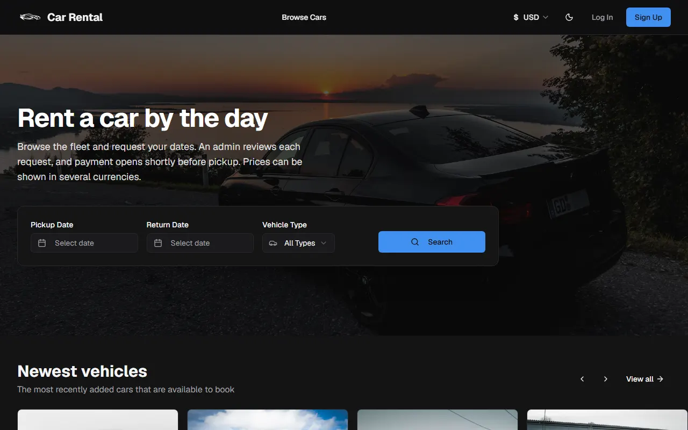
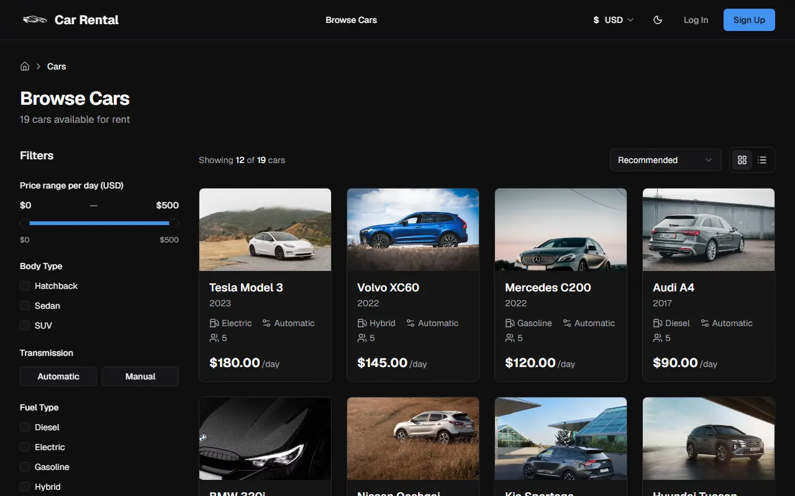
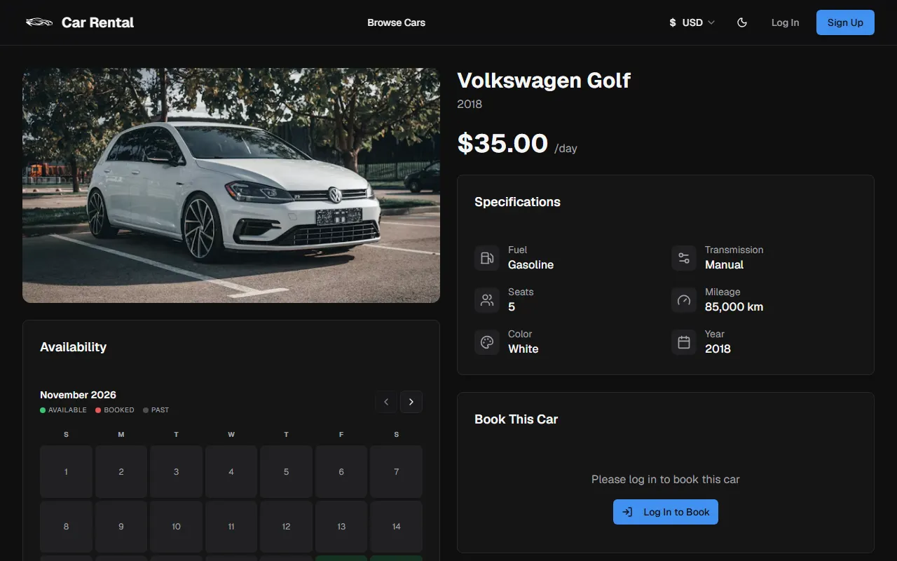
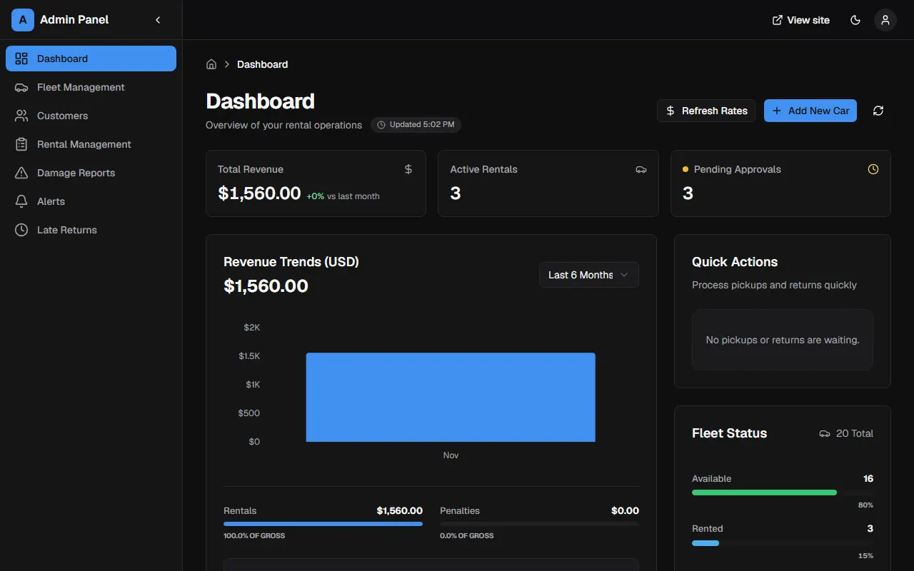
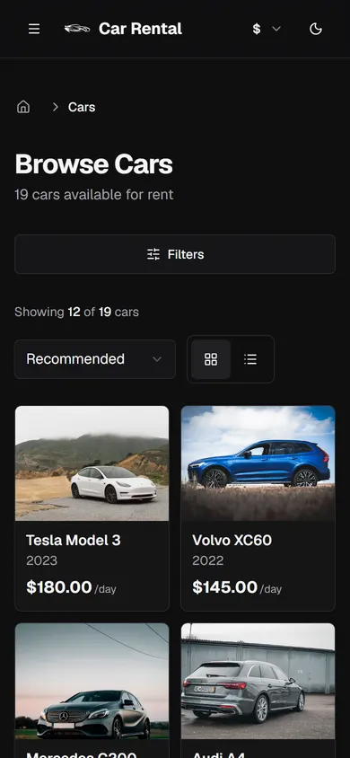
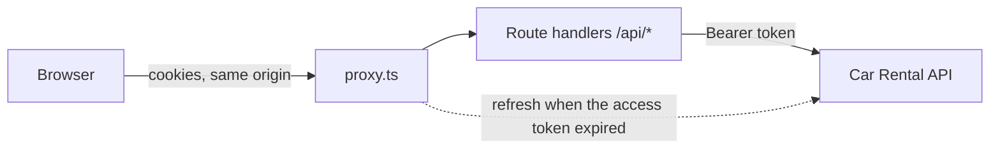

# Car Rental Web

The customer and admin web client for the [Car Rental API](https://github.com/TheOdrig/car-rental-api), built with Next.js. Customers browse the catalogue, check availability, request a rental and pay for it; admins confirm rentals, manage the fleet and users, and handle damages and late returns.

This is a portfolio project, built to show how a Next.js client is structured, kept in step with an API contract and verified. It is not deployed anywhere, and Stripe runs in test mode only.



| Browse cars | Car detail | Admin dashboard | Phone (390 px) |
| --- | --- | --- | --- |
|  |  |  |  |

Screenshots were taken against the API running from Docker Compose with its seed data.

## Quick start

You need Node 22 and Docker.

1. In a checkout of [car-rental-api](https://github.com/TheOdrig/car-rental-api), run `docker compose up --build`. The API starts on http://localhost:8082 with seed data and a stub payment gateway.
2. In this repository, run `cp .env.example .env.local`.
3. Set `JWT_SECRET` in `.env.local` to the API's signing secret. The API's `dev` profile defaults to `dev-only-jwt-secret-do-not-use-outside-local-development-0123456789`; use that for local work.
4. Run `npm ci`, then `npm run dev`.
5. Open http://localhost:3000. The seed includes an admin account (`admin` / `Admin123!`).

Without a `pk_test_` Stripe key, the pay page refuses to render the card form, by design. Stop the API and delete its data with `docker compose down -v`.

## Architecture

The source follows Feature-Sliced Design (`app`, `widgets`, `features`, `entities`, `shared` under [`src`](src)); imports only point downward and ESLint enforces it. The browser never talks to the API: it calls Next route handlers under [`src/app/api`](src/app/api), which call the API from the server.



## Highlights

| Topic | What it does | Proof |
| --- | --- | --- |
| Layer boundaries | Downward-only imports and public `index.ts` entry points are lint errors | [`eslint.config.mjs`](eslint.config.mjs), [`src/__tests__/architecture`](src/__tests__/architecture) |
| Session handling | Tokens live in httpOnly cookies; `proxy.ts` verifies the JWT and refreshes it once per token | [`proxy.test.ts`](src/__tests__/proxy.test.ts), [`upstream.ts`](src/shared/server/upstream.ts) |
| Request guards | State-changing handlers reject a cross-origin `Origin` with 403 and a wrong `Content-Type` with 415 | [`route.test.ts`](src/shared/server/__tests__/route.test.ts) |
| API contract | Types are generated from a committed OpenAPI snapshot; drift fails `verify` | [`scripts/contract.mjs`](scripts/contract.mjs), [`upstream-contract.test.ts`](src/shared/server/__tests__/upstream-contract.test.ts) |
| Errors | RFC 9457 problem details become a typed `ApiError`; an unreachable API is a 503, a timeout a 504 | [`error.test.ts`](src/shared/api/__tests__/error.test.ts) |
| Payments | Stripe Payment Element with `redirect: 'if_required'`, polled with back-off, `pk_test_` keys only | [`pay-rental.test.tsx`](src/features/pay-rental/__tests__/pay-rental.test.tsx), [`env-stripe.test.ts`](src/shared/server/__tests__/env-stripe.test.ts) |
| Safe redirects | `callbackUrl` accepts same-origin paths only; the OAuth state is compared in constant time | [`safe-redirect.test.ts`](src/shared/lib/__tests__/safe-redirect.test.ts), [`oauth-flow.test.ts`](src/app/api/auth/_lib/__tests__/oauth-flow.test.ts) |

## Stack

Next.js (App Router), React, TypeScript, TanStack Query, Zustand, Zod, Tailwind CSS, Radix UI, jose, Stripe Elements, openapi-typescript, Vitest, Testing Library, MSW and Playwright with axe-core. Versions are in [`package.json`](package.json).

## Verify

```bash
bash scripts/verify.sh
```

On Windows use [`scripts/verify.ps1`](scripts/verify.ps1). It checks the Node version and that no AI or planning files are tracked, then runs lint with zero warnings, the contract check, type check, the unit and architecture tests, a dependency audit and the production build. There is no hosted CI; this local gate is the check. End-to-end tests against the real API run with `npm run test:e2e:stack`.

Environment variables are listed in [`.env.example`](.env.example).

## License

[MIT](LICENSE)
