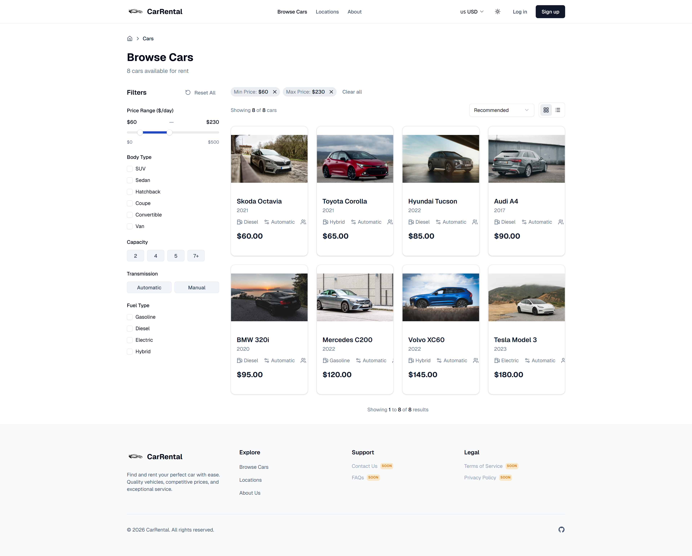
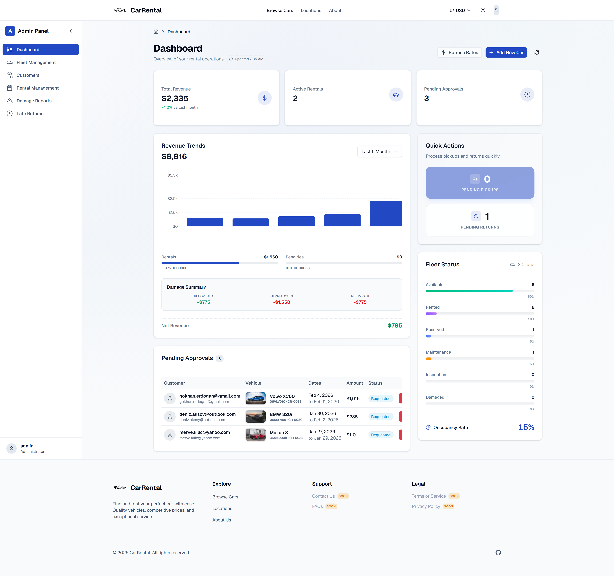
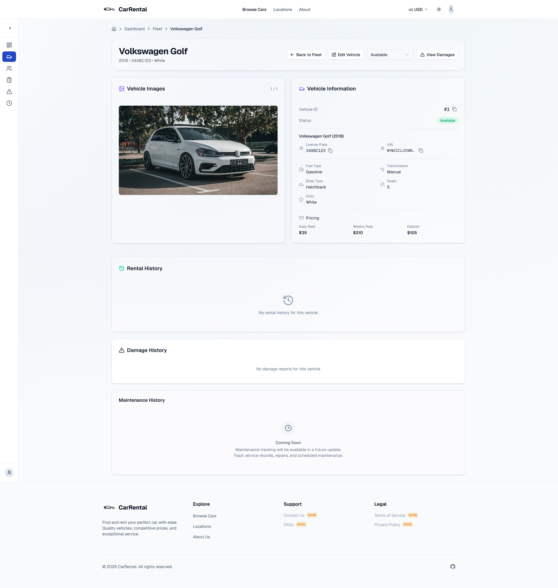
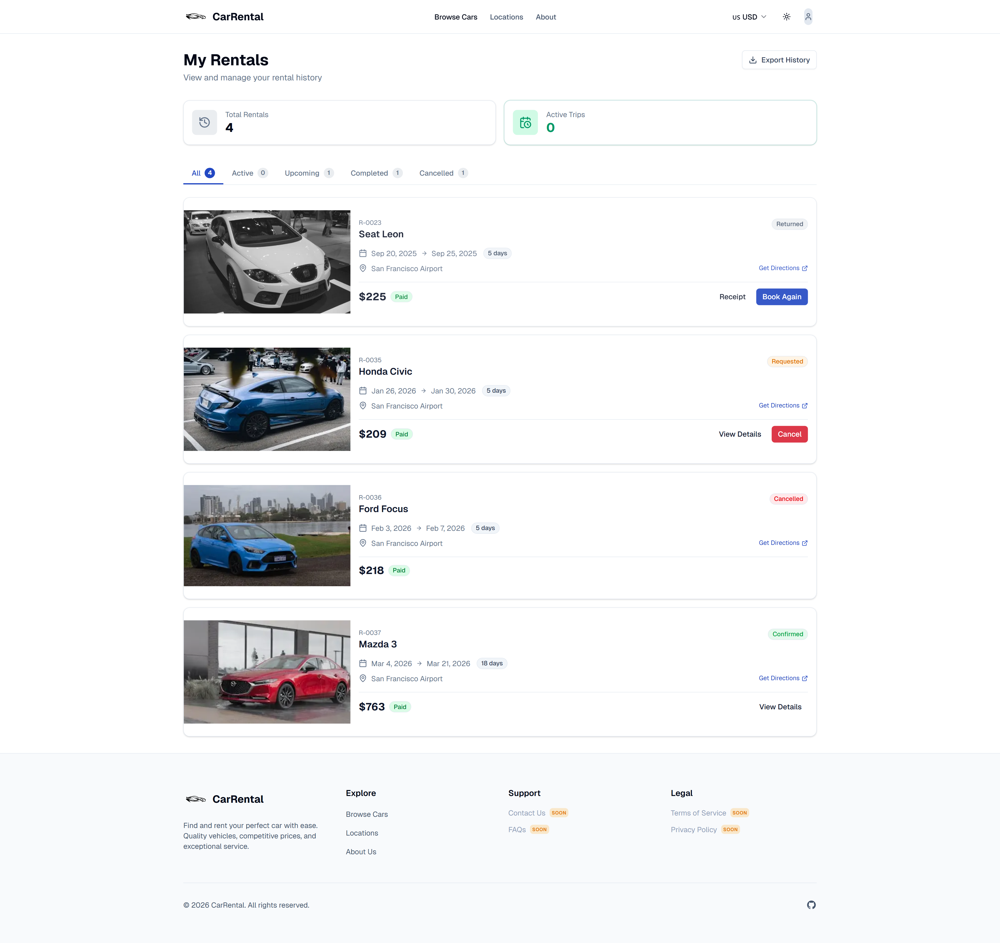
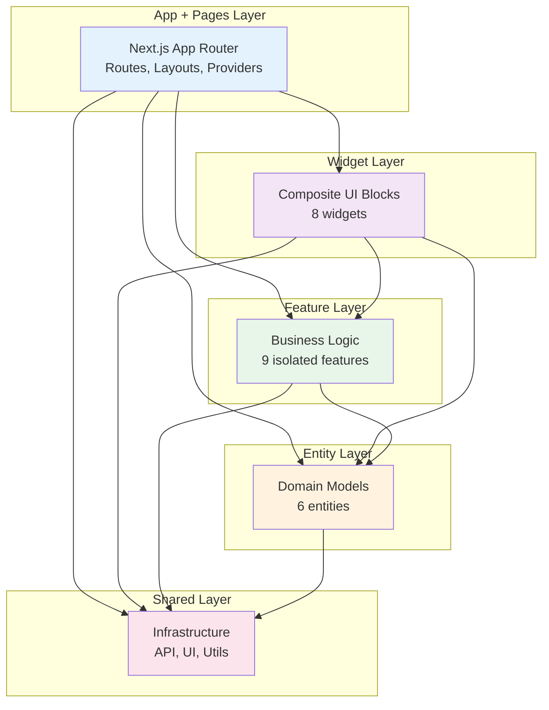
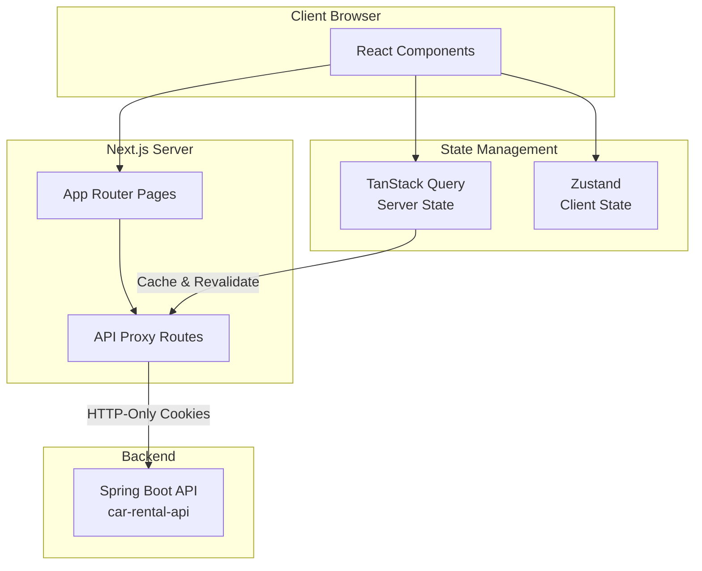

# 🚗 Car Rental Web

A production-ready frontend for car rental management, built with **Next.js 16.1** and **TypeScript**.

[](https://nextjs.org/)
[](https://www.typescriptlang.org/)
[](https://tailwindcss.com/)
[](/)
[](LICENSE)

> **🚀 Live Demo:** [arabakiralama.site](https://arabakiralama.site)

---

## 📸 Screenshots

<details open>
<summary><b>🏠 Landing Page</b></summary>


*Hero section with featured cars and search functionality*

</details>

<details>
<summary><b>🚗 Car Catalog</b></summary>


*Advanced filtering with brand, transmission, fuel type, and availability dates*

</details>

<details>
<summary><b>📊 Admin Dashboard</b></summary>


*Real-time metrics, alerts, and quick actions for fleet management*

</details>

<details>
<summary><b>🔍 Car Detail</b></summary>


*Interactive availability calendar and comprehensive vehicle specifications*

</details>

<details>
<summary><b>👤 User Dashboard</b></summary>


*Rental history and status tracking*

</details>

<details>
<summary><b>🛡️ Admin Fleet Management</b></summary>


*Fleet status overview and vehicle management*

</details>

<details>
<summary><b>🌙 Dark Mode Support</b></summary>


*Admin Fleet Management with dark theme - Seamless theme switching*

</details>

---


## ✨ Features

| Feature | Description |
|---------|-------------|
| **Smart Search** | Filter cars by brand, transmission, fuel type, availability dates |
| **Interactive Details** | Real-time availability calendar, comprehensive specs, dynamic pricing |
| **Booking Flow** | Request → Confirm → Pickup → Return workflow with status tracking |
| **User Dashboard** | Manage rentals, view history, update profile, payment methods |
| **Admin Dashboard** | Fleet management, rental approvals, revenue analytics, quick actions |
| **Authentication** | JWT + OAuth2 (Google, GitHub), HTTP-Only cookies, secure sessions |
| **Payment Integration** | Stripe checkout, payment history, refund management |
| **Damage Reporting** | Photo upload, assessment workflow, dispute resolution |
| **Currency Conversion** | Real-time exchange rates, multi-currency support |
| **Responsive Design** | Mobile-first, dark/light mode, accessibility compliant |

## 🏗️ Architecture

This frontend uses **Feature-Sliced Design (FSD)** with **Next.js App Router** and API Proxy pattern for secure backend communication.

<details>
<summary>📊 <b>View FSD Layer Diagram</b></summary>



</details>

<details>
<summary>🔄 <b>View Application Flow</b></summary>



</details>

### Route Groups

| Route Group | Purpose | Authentication |
|-------------|---------|----------------|
| `(public)` | Landing, car browsing, search | Public |
| `(auth)` | Login, register, OAuth2 callback | Public |
| `(protected)` | User dashboard, my rentals, settings | Required (USER) |
| `(admin)` | Fleet management, approvals, analytics | Required (ADMIN) |

### API Proxy Pattern

```
Client → Next.js API Route → Backend API
         ↓ (attaches cookie)
         ↓ (handles CORS)
         ↓ (error transformation)
```

**Benefits:**
- ✅ HTTP-Only cookies (XSS protection)
- ✅ No CORS issues
- ✅ Centralized error handling
- ✅ Request/response transformation

## 🛠️ Tech Stack

| Category | Technology |
|----------|------------|
| Framework | Next.js 16.1 (App Router) |
| Language | TypeScript 5.x |
| Styling | Tailwind CSS v4, shadcn/ui |
| State Management | Zustand (client), TanStack Query (server) |
| Forms | react-hook-form, Zod validation |
| Testing | Vitest, React Testing Library, fast-check |
| Auth | JWT, OAuth2 (Google, GitHub) |
| Payment | Stripe Elements (Planned) |
| Icons | lucide-react |
| Date | date-fns |

## 🚀 Quick Start

### Prerequisites
- Node.js 18+ (LTS recommended)
- Running [Car Rental API](https://github.com/TheOdrig/car-rental-api) backend

### Setup

```bash
# Clone
git clone https://github.com/TheOdrig/car-rental-web.git
cd car-rental-web

# Install dependencies
npm install

# Configure environment
cp .env.example .env
# Edit .env with your backend URL

# Run development server
npm run dev
```

### Access
- **Frontend:** `http://localhost:3000`
- **Backend API:** `http://localhost:8082` (must be running)

## 📱 Pages Overview

### Public Pages
```
/                    # Landing page with featured cars
/cars                # Car catalog with filters
/cars/[id]           # Car details with availability calendar
/about               # About page
/locations           # Rental locations
```

### Authentication
```
/login               # Email/password login
/register            # User registration
/oauth2/callback     # OAuth2 redirect handler
```

### User Dashboard (Protected)
```
/dashboard           # My rentals overview
/dashboard/rentals   # Rental history
/dashboard/settings  # Profile settings
```

### Admin Dashboard (Admin Only)
```
/admin               # Admin overview with metrics
/admin/fleet         # Fleet management
/admin/fleet/[id]    # Vehicle details
/admin/rentals       # Rental approvals
/admin/rentals/[id]  # Rental details
/admin/users         # User management
/admin/users/[id]    # User details
```

## 🧪 Testing

```bash
# Run all tests
npm test

# Watch mode
npm run test:watch

# Architecture tests only
npm run test:architecture

# Coverage report
npm run test:coverage
```

**Test Coverage:**
- 68 tests passing (47 unit + 21 architecture)
- 80%+ coverage for auth, book-car, manage-rentals
- FSD boundary verification (0 violations)
- Property-based tests with fast-check

## 📂 Project Structure (FSD Architecture)

```
src/
├── app/                 # App + Pages Layer (Next.js App Router)
│   ├── (public)/        # Public route group
│   ├── (auth)/          # Auth route group
│   ├── (protected)/     # Protected route group
│   ├── (admin)/         # Admin route group
│   ├── api/             # API Proxy Routes
│   ├── layout.tsx       # Root layout
│   └── providers.tsx    # Global providers
├── widgets/             # Widget Layer (Composite UI blocks)
│   ├── header/          # Navigation header
│   ├── car-filters/     # Car filtering widget
│   ├── car-search/      # Search widget
│   ├── car-booking-card/# Booking card widget
│   ├── damage-report/   # Damage reporting widget
│   ├── home/            # Home page widgets
│   ├── layout/          # Layout widgets
│   └── rental-dashboard/# Rental dashboard widget
├── features/            # Feature Layer (Business logic & user actions)
│   ├── auth/            # Authentication feature
│   ├── book-car/        # Car booking feature
│   ├── manage-rentals/  # Rental management feature
│   ├── manage-fleet/    # Fleet management feature
│   ├── manage-users/    # User management feature
│   ├── process-rentals/ # Rental processing feature
│   ├── manage-damages/  # Damage management feature
│   ├── user-settings/   # User settings feature
│   └── admin/           # Admin feature
├── entities/            # Entity Layer (Domain models)
│   ├── car/             # Car entity (types, store, utils, UI)
│   ├── user/            # User entity (types, store, utils)
│   ├── rental/          # Rental entity (types, store, utils)
│   ├── currency/        # Currency entity (types, store, utils, UI)
│   ├── damage/          # Damage entity (types, store, utils, UI)
│   └── payment/         # Payment entity (types)
├── shared/              # Shared Layer (Infrastructure)
│   ├── api/             # API client
│   ├── config/          # Configuration
│   ├── events/          # Event bus
│   ├── lib/             # Utilities
│   ├── types/           # Shared types
│   └── ui/              # UI primitives (shadcn/ui)
└── __tests__/           # Architecture tests
    └── architecture/    # FSD boundary tests
```

**Layer Dependencies (Enforced by ESLint):**
- `app` → `widgets`, `features`, `entities`, `shared`
- `widgets` → `features`, `entities`, `shared`
- `features` → `entities`, `shared` (no cross-feature imports)
- `entities` → `entities` (via `@x`), `shared`
- `shared` → `shared` only

## 🔧 Configuration

See [docs/operations/ENVIRONMENT_VARIABLES.md](docs/operations/ENVIRONMENT_VARIABLES.md) for detailed configuration options including:
- Backend API URLs (browser vs server-side)
- JWT secret configuration
- OAuth2 providers (Google, GitHub)
- Cache configuration

**Quick Reference:**

```env
# Backend API URL (Browser Access)
NEXT_PUBLIC_API_URL=http://localhost:8082

# Internal API URL (Server-side Access / Docker Network)
API_URL=http://localhost:8082

# JWT Secret - Must match the backend JWT signing key
JWT_SECRET=your-jwt-secret-key-here
```

## 📊 Technical Highlights

- **Feature-Sliced Design** with 5 layers, 9 features, 6 entities, 8 widgets
- **68% Backend Parity** with Spring Modulith (enforced boundaries, event-driven)
- **21 Architecture Properties** verified with Vitest + ESLint boundaries
- **68 Automated Tests** (47 unit + 21 architecture) with 80%+ coverage
- **Type Safety** with 0 `any` types, 0 `@ts-ignore`
- **9 ADRs** documenting architectural decisions
- **API Proxy Pattern** for secure backend communication (HTTP-Only cookies)

## 🤝 Contributing

Contributions are welcome! Please read the [Contributing Guidelines](CONTRIBUTING.md) before submitting a pull request.

Quick steps:
1. Fork the repository
2. Create feature branch (`git checkout -b feature/amazing-feature`)
3. Run tests (`npm test`)
4. Commit using [Conventional Commits](https://www.conventionalcommits.org/)
5. Push and open Pull Request

## 📋 Changelog

See [CHANGELOG.md](CHANGELOG.md) for version history and notable changes.

## 📝 Documentation

### Getting Started
- **[DEVELOPER_GUIDE.md](DEVELOPER_GUIDE.md)** - Complete development guide
- **[CONTRIBUTING.md](CONTRIBUTING.md)** - Contribution guidelines
- **[CHANGELOG.md](CHANGELOG.md)** - Version history

### Architecture & Design
- **[docs/architecture/](docs/architecture/)** - FSD guide, diagrams, ADRs
- **[docs/features/](docs/features/)** - Feature catalog
- **[docs/testing/](docs/testing/)** - Test strategy

📖 See [docs/](docs/) for complete documentation.

## 📄 License

This project is licensed under the MIT License. See the [LICENSE](LICENSE) file for details.

## 👤 Author

**Mehmet Akif Uludag**

[](https://github.com/TheOdrig)

---

**Backend Repository:** [car-rental-api](https://github.com/TheOdrig/car-rental-api)
