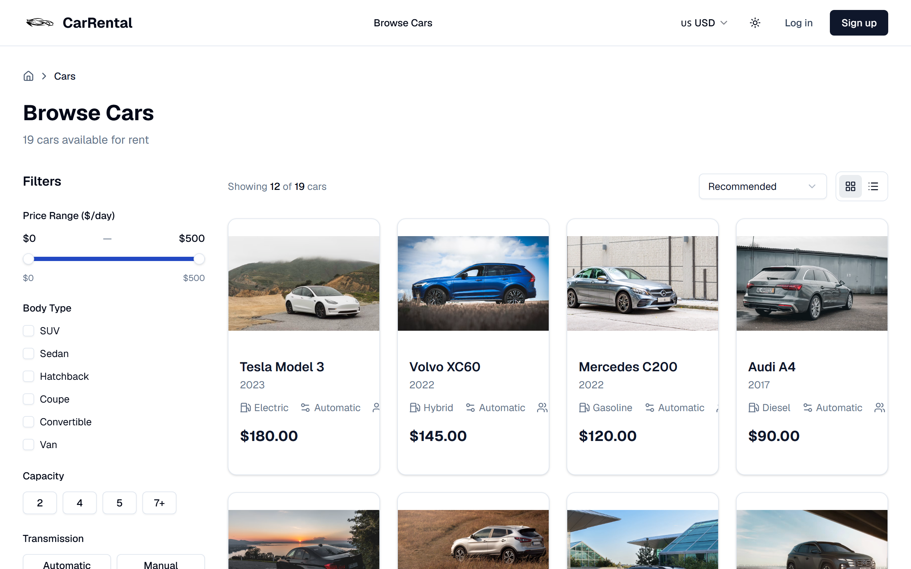
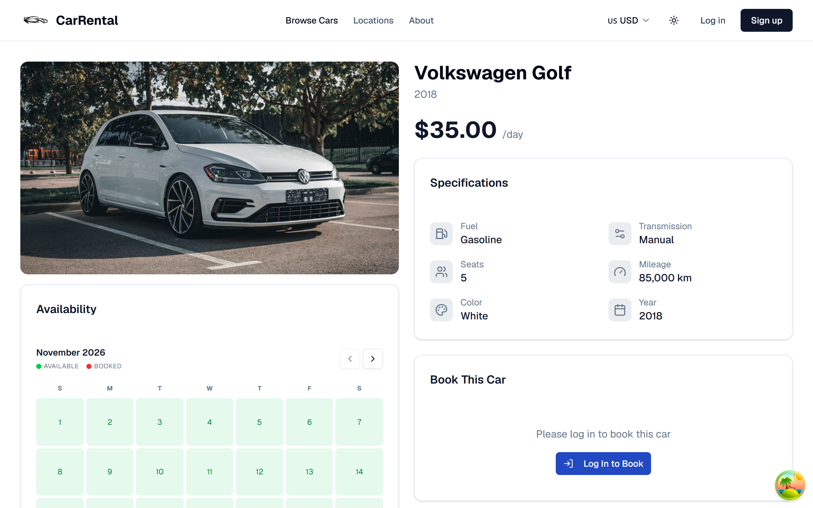
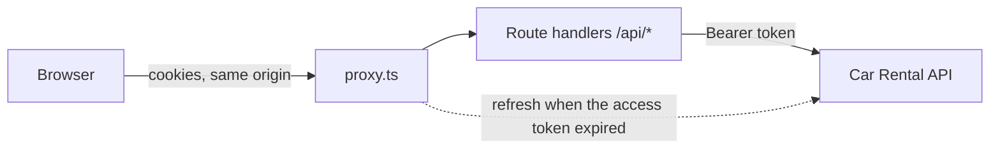

# Car Rental Web

The customer and admin web client for the [Car Rental API](https://github.com/TheOdrig/car-rental). Customers browse the catalogue, check availability, request a rental and pay for it; admins confirm rentals, manage the fleet and users, and handle damages and late returns. It is a portfolio project, built to show how a Next.js client is structured, kept in step with an API contract and verified; it is not a deployed product. Stripe runs in test mode only.


| Browse cars | Car detail with availability |
| --- | --- |
|  |  |

Screenshots were taken against the API running from Docker Compose with its seed data.

History: everything up to the tag `v1-learning-baseline` is the original learning build; the 2026-11 refactor follows it.

## Stack

| Area | Choice |
| --- | --- |
| Framework | Next.js 16.4.6 (App Router), React 19.2.3, TypeScript 5.9 ([`package.json`](package.json)) |
| Data and state | TanStack Query 5.90, Zustand 5.0, react-hook-form with Zod 4.6 |
| UI | Tailwind CSS 4, Radix UI primitives, shadcn-style components |
| Auth | jose 6.1 (JWT verification on the server), httpOnly cookies |
| Payments | Stripe Elements (`@stripe/react-stripe-js` 7.1, `@stripe/stripe-js` 10.3), test mode |
| Contract | openapi-typescript 7.13 generating types from a committed OpenAPI snapshot |
| Tests | Vitest 4, Testing Library, fast-check, Playwright 1.56 |
| Architecture checks | ESLint 9 with eslint-plugin-boundaries 5.3 |

Node 20 (see [`.nvmrc`](.nvmrc), the Dockerfile builds on it) or Node 22 is required: `engines` in `package.json` allows only those majors, `.npmrc` turns on `engine-strict`, and `scripts/check-node.mjs` repeats the check in `verify`.

## Architecture

### Layers

The source is organised by Feature-Sliced Design: `app`, `widgets`, `features`, `entities`, `shared` under [`src`](src). Imports may only point downward, and slices are reached through their public `index.ts`. [`eslint.config.mjs`](eslint.config.mjs) enforces both with `boundaries/element-types` and `boundaries/no-private`, and the property tests in [`src/__tests__/architecture`](src/__tests__/architecture) check related rules such as server/client separation and type safety. `npm run lint` fails on any warning.

### Backend for frontend

The browser never talks to the API. It calls Next route handlers under [`src/app/api`](src/app/api), which call the API from the server.



- **Cookies.** Access and refresh tokens live in httpOnly cookies, `secure` in production and `sameSite=lax` ([`auth-cookies.ts`](src/shared/server/auth-cookies.ts)). Client code never sees a token.
- **Verification.** [`proxy.ts`](src/proxy.ts) verifies the access token with jose (HS256) before protected, admin and admin-API paths are served ([`session.ts`](src/shared/server/session.ts)). Which path needs what is declared in [`route-access.ts`](src/shared/config/route-access.ts) and covered by [`proxy.test.ts`](src/__tests__/proxy.test.ts).
- **Refresh.** An expired access token is renewed with the refresh token. The API rotates refresh tokens, so concurrent requests would otherwise race on one token. [`refreshAuthSession`](src/shared/server/upstream.ts) shares one in-flight promise per token for a short window, and the browser-side [`clientFetch`](src/shared/api/client.ts) does the same for 401 retries.
- **Guards.** Every state-changing handler built with [`route()`](src/shared/server/route.ts) rejects a cross-origin `Origin` header with 403 and an unexpected `Content-Type` with 415 before running ([`route.test.ts`](src/shared/server/__tests__/route.test.ts)).
- **Upstream endpoint registry.** Handlers do not build URLs by hand; they resolve a typed entry from [`upstream-endpoints.ts`](src/shared/server/upstream-endpoints.ts), so a path or method change is a single edit.
- **Client IP forwarding.** The API rate-limits per client address, so every upstream call sends `X-Client-IP`. [`client-ip.ts`](src/shared/server/client-ip.ts) derives it from the incoming request: with `TRUSTED_PROXY_HOPS=0` (the default) nothing is forwarded, with N it takes the Nth entry from the right of `X-Forwarded-For`, and `TRUSTED_CLIENT_IP_HEADER` can name a header your edge sets. A client-supplied `X-Client-IP` is never forwarded ([`client-ip.test.ts`](src/shared/server/__tests__/client-ip.test.ts), [`upstream.test.ts`](src/shared/server/__tests__/upstream.test.ts)).
- **Security headers.** [`next.config.ts`](next.config.ts) sends a Content-Security-Policy that allows Stripe (`js.stripe.com`, `*.stripe.com` frames, `api.stripe.com`) and https images, `frame-ancestors 'none'` with `X-Frame-Options: DENY`, `nosniff`, a strict referrer policy, a permissions policy and, in production, HSTS. Scripts still need `'unsafe-inline'` because pages do not use nonces yet ([`security-headers.test.ts`](src/__tests__/security-headers.test.ts)).
- **Configuration.** Server environment is parsed once with Zod ([`env.ts`](src/shared/server/env.ts)); a missing or short `JWT_SECRET` fails fast.

## Engineering notes

- **Generated contract types.** [`contract/openapi.json`](contract/openapi.json) is a snapshot of the API's OpenAPI document. [`scripts/contract.mjs`](scripts/contract.mjs) generates [`src/shared/api/generated/openapi.ts`](src/shared/api/generated/openapi.ts) from it (`npm run contract:generate`), and `npm run contract:check`, part of `verify`, fails if the committed types differ from a fresh generation. `npm run contract:sync` copies the snapshot from a sibling `car-rental-api` checkout, and when that checkout exists `contract:check` fails if its spec differs from the snapshot. Response types are derived from these schemas through [`contract.ts`](src/shared/api/contract.ts) rather than written by hand.
- **Three contract tests.** [`upstream-contract.test.ts`](src/shared/server/__tests__/upstream-contract.test.ts) checks that every registered upstream endpoint exists in the snapshot. [`bff-client-contract.test.ts`](src/app/api/__tests__/bff-client-contract.test.ts) checks that the BFF routes the client code calls exist. [`error-codes-contract.test.ts`](src/app/api/__tests__/error-codes-contract.test.ts) checks that every error code the web matches on is in the API's error code enum.
- **Errors.** The API reports failures as RFC 9457 problem details. [`error.ts`](src/shared/api/error.ts) turns them into an `ApiError` with status, code, field errors, trace id and `Retry-After` ([`error.test.ts`](src/shared/api/__tests__/error.test.ts)), and the BFF answers with `application/problem+json` of the same shape ([`route.ts`](src/shared/server/route.ts)). An unreachable API becomes a 503 and a timeout a 504.
- **Stripe payment flow.** The API creates a PaymentIntent with manual capture; the pay page ([`pay-rental.tsx`](src/features/pay-rental/ui/pay-rental.tsx)) mounts the Payment Element and calls `confirmPayment` with `redirect: 'if_required'`, so a 3DS redirect returns to the page and resumes by polling instead of creating a second intent. Status is polled with exponential back-off and a cap ([`use-rental-payment.ts`](src/entities/payment/lib/use-rental-payment.ts)); on timeout the customer is told not to pay again. Only `pk_test_` publishable keys are accepted, on the server ([`env.ts`](src/shared/server/env.ts), [`env-stripe.test.ts`](src/shared/server/__tests__/env-stripe.test.ts)) and in the browser ([`stripe-client.ts`](src/features/pay-rental/lib/stripe-client.ts)). The states are covered by [`pay-rental.test.tsx`](src/features/pay-rental/__tests__/pay-rental.test.tsx) with Stripe mocked; no test here drives real Stripe.
- **Auth and sessions.** Login, registration, logout and refresh go through [`src/app/api/auth`](src/app/api/auth); roles come from the verified JWT claims, and admin pages and `/api/admin` refuse a non-admin ([`session.test.ts`](src/shared/server/__tests__/session.test.ts), [`admin-routes.test.ts`](src/app/api/__tests__/admin-routes.test.ts)).
- **Safe redirects and OAuth state.** [`safeRedirectPath`](src/shared/lib/safe-redirect.ts) accepts only same-origin paths for `callbackUrl` and rejects `//`, backslashes and control characters ([`safe-redirect.test.ts`](src/shared/lib/__tests__/safe-redirect.test.ts)). The OAuth flow stores a state value in a short-lived httpOnly cookie and compares it in constant time on the callback ([`oauth-state.ts`](src/app/api/auth/_lib/oauth-state.ts), [`oauth-flow.test.ts`](src/app/api/auth/_lib/__tests__/oauth-flow.test.ts)).
- **Stack e2e suite.** [`e2e-stack`](e2e-stack) holds eleven Playwright tests that run against the real API in Docker Compose: register and log in, a wrong password, catalogue browsing and sorting, car detail with its calendar, booking followed by admin confirmation and the pay page (checked for CSP violations), the admin routes, the security headers and client IP forwarding (separate login rate-limit buckets for two forwarded addresses, which only holds when the API trusts `X-Client-IP`). They are not part of `verify`, because they need the API running.

## Quick start

You need Node 20 or 22 and the API running locally. In a checkout of [car-rental](https://github.com/TheOdrig/car-rental):

```bash
docker compose up --build
```

This starts PostgreSQL and the API on http://localhost:8082 with seed data and a stub payment gateway; no Stripe or OAuth credentials are needed. Then, in this repository:

```bash
cp .env.example .env.local
```

Set `JWT_SECRET` in `.env.local` to the API's signing secret before starting. The API's `dev` profile defaults to `dev-only-jwt-secret-do-not-use-outside-local-development-0123456789`, so use that for local work. Then:

```bash
npm ci
npm run dev
```

The app is at http://localhost:3000.

The seed data includes an admin account (`admin` / `Admin123!`, also used by the stack e2e suite). Without a `pk_test_` key in `STRIPE_PUBLISHABLE_KEY` or from the API, the pay page refuses to render the card form, by design.

Stop the API and delete its data with `docker compose down -v`.

## Verify

```bash
bash scripts/verify.sh
```

[`scripts/verify.sh`](scripts/verify.sh) checks the Node version, runs [`scripts/check-no-ai-files.mjs`](scripts/check-no-ai-files.mjs) (fails if AI-tooling or planning files are tracked, at any depth), `npm run lint` with zero warnings allowed, `npm run contract:check`, `npm run type-check` and `npm test`, then `npm audit --omit=dev --audit-level=high` and `npm run build`. It also runs `scripts/verify.local.sh` when that file exists, for checks that are not part of the repository, and prints `local checks: none` otherwise. On Windows use [`scripts/verify.ps1`](scripts/verify.ps1). `npm test` runs 1,359 Vitest tests (all passing, none skipped) at the last full run, including the architecture, contract and security-header tests.

The [Husky](.husky) pre-push hook runs `bash scripts/verify.sh --fast`, which skips the audit and the build to stay under about three minutes; the full run, with the build, takes a little longer. There is no hosted CI; this local gate is the check.

With the API running, `npm run test:e2e:stack` starts the web app on port 3100 against `http://localhost:8082` and runs the stack suite; `E2E_API_URL` and `E2E_BASE_URL` override the targets. The suite starts the web app with `TRUSTED_PROXY_HOPS=1` (`E2E_TRUSTED_PROXY_HOPS` overrides it), and the API must trust the web server for the client IP test: set `SECURITY_RATELIMIT_TRUSTEDCLIENTIPHEADER=X-Client-IP` and `SECURITY_RATELIMIT_TRUSTEDPROXYCIDRS` to the range the web server connects from (in the dev profile, which has no env mapping for them; the prod profile reads `TRUSTED_CLIENT_IP_HEADER` and `TRUSTED_PROXY_CIDRS`). `npm run e2e` runs a separate smoke test against an app that is already running.

## Configuration

[`.env.example`](.env.example) lists the variables.

| Variable | Purpose |
| --- | --- |
| `API_URL` | Base URL of the API, default `http://localhost:8082`; required when `NODE_ENV=production` |
| `JWT_SECRET` | Required, at least 32 characters, the HS256 secret the API signs with |
| `API_TIMEOUT_MS` | Upstream timeout, default 5000 |
| `TRUSTED_PROXY_HOPS` | Number of trusted reverse proxies in front of this app, default 0; used to pick the client IP from `X-Forwarded-For` |
| `TRUSTED_CLIENT_IP_HEADER` | Optional name of a header your edge sets with the client IP, for example `x-real-ip`; only used when set |
| `NEXT_PUBLIC_APP_URL` | Public URL of this app |
| `STRIPE_PUBLISHABLE_KEY` | Optional fallback; must start with `pk_test_` |

## License

[MIT](LICENSE)
