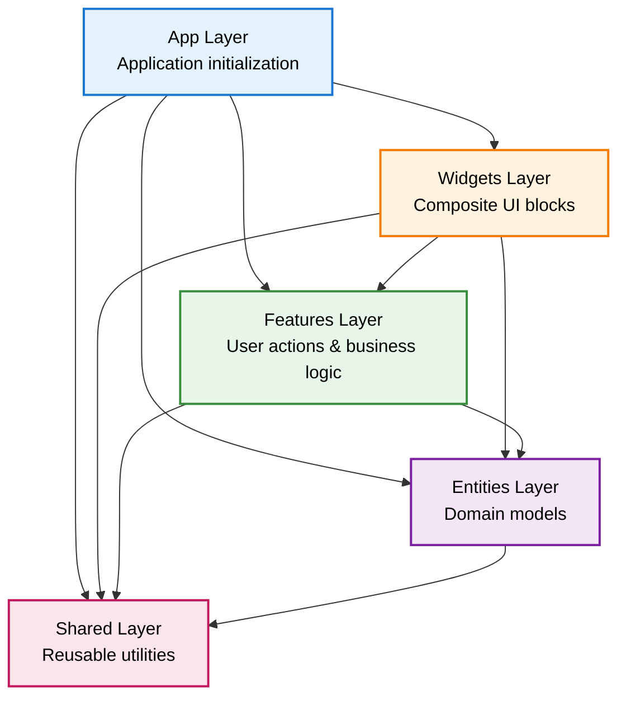
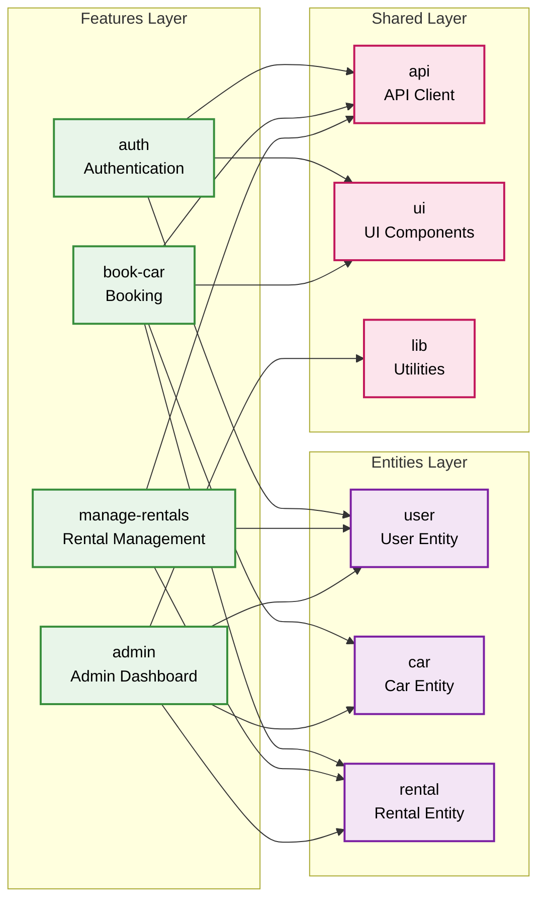
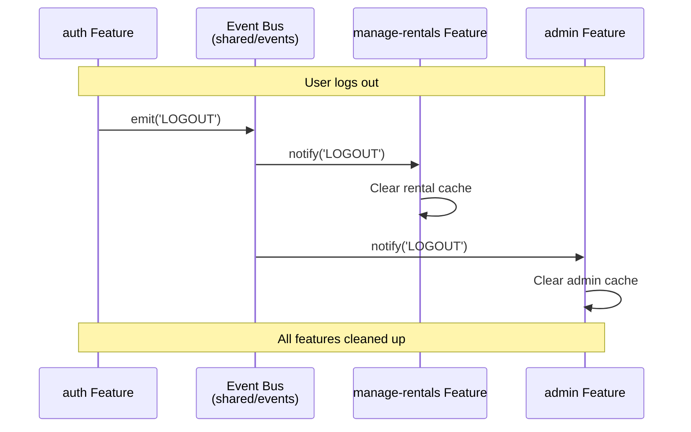
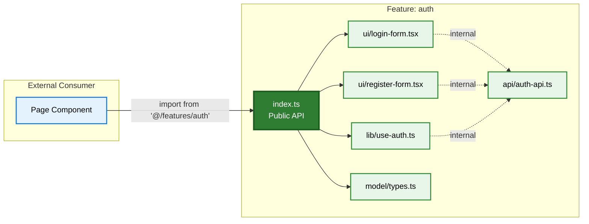
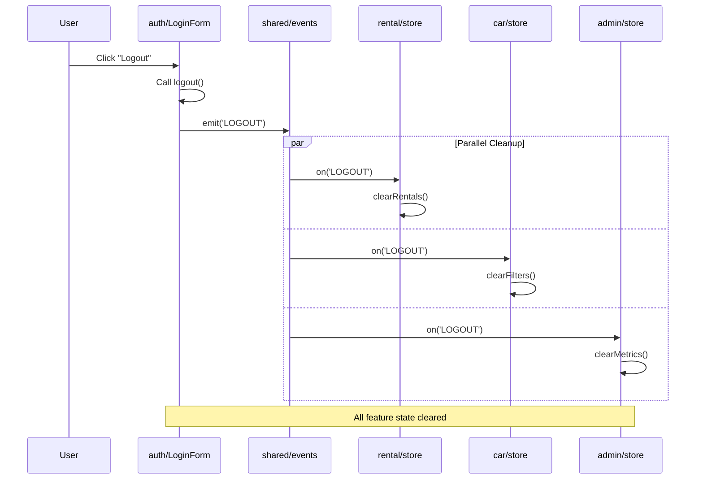
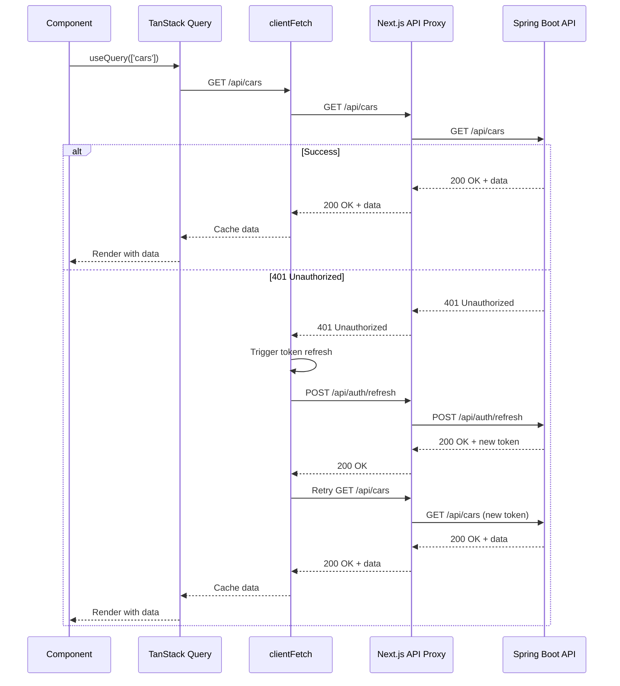
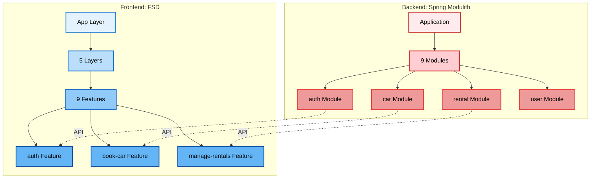

# Architecture Diagrams

This document provides visual representations of the CarRental frontend architecture using Mermaid diagrams.

---

## Table of Contents

1. [FSD Layer Architecture](#fsd-layer-architecture)
2. [Feature Isolation](#feature-isolation)
3. [Event Bus Communication](#event-bus-communication)
4. [Public API Pattern](#public-api-pattern)
5. [Data Flow](#data-flow)
6. [State Management](#state-management)
7. [Backend Comparison](#backend-comparison)

---

## FSD Layer Architecture

### Layer Dependency Hierarchy



**Rules:**
- **Unidirectional dependencies:** Higher layers can import from lower layers only
- **No circular dependencies:** Layer A cannot import from Layer B if B imports from A
- **Shared is independent:** No imports from other layers

---

## Feature Isolation

### No Cross-Feature Imports



**Key Principle:** Features are isolated and cannot import from each other. They communicate via:
1. **Props** (passed from parent pages/widgets)
2. **Global stores** (Zustand)
3. **Event bus** (decoupled communication)

---

## Event Bus Communication

### Cross-Feature Communication Pattern



**Event Bus Implementation:**

```typescript
// shared/events/event-bus.ts
type EventCallback = (data?: unknown) => void;

class EventBus {
  private events: Map<string, EventCallback[]> = new Map();

  emit(event: string, data?: unknown) {
    const callbacks = this.events.get(event) || [];
    callbacks.forEach(callback => callback(data));
  }

  on(event: string, callback: EventCallback) {
    const callbacks = this.events.get(event) || [];
    this.events.set(event, [...callbacks, callback]);
  }

  off(event: string, callback: EventCallback) {
    const callbacks = this.events.get(event) || [];
    this.events.set(event, callbacks.filter(cb => cb !== callback));
  }
}

export const eventBus = new EventBus();
```

---

## Public API Pattern

### Index.ts Exports



**Example Public API:**

```typescript
// features/auth/index.ts
export { LoginForm, RegisterForm } from './ui';
export { useAuth, useLogin, useLogout } from './lib';
export type { User, LoginRequest, RegisterRequest } from './model/types';
export { getAccessToken, clearAuthTokens } from './lib/cookies';
```

**Rules:**
- ✅ **Do:** Import from feature's public API (`@/features/auth`)
- ❌ **Don't:** Import from internal files (`@/features/auth/ui/login-form`)

---

## Data Flow

### Complete Data Flow Architecture

```mermaid
graph TB
    subgraph "App Layer"
        Layout[Layout<br/>Global providers]
    end
    
    subgraph "Pages Layer"
        CarsPage[Cars Page<br/>Route: /cars]
        DashboardPage[Dashboard Page<br/>Route: /dashboard]
    end
    
    subgraph "Widgets Layer"
        CarFilters[Car Filters Widget]
        RentalDashboard[Rental Dashboard Widget]
    end
    
    subgraph "Features Layer"
        BookCar[book-car Feature]
        ManageRentals[manage-rentals Feature]
    end
    
    subgraph "Entities Layer"
        CarEntity[car Entity<br/>Store + Types]
        RentalEntity[rental Entity<br/>Store + Types]
    end
    
    subgraph "Shared Layer"
        APIClient[api/client.ts<br/>HTTP Client]
        UIComponents[ui/*<br/>Button, Input, Card]
    end
    
    subgraph "Backend"
        Backend[Spring Boot API<br/>Port 8082]
    end
    
    Layout --> CarsPage
    Layout --> DashboardPage
    
    CarsPage --> CarFilters
    DashboardPage --> RentalDashboard
    
    CarFilters --> BookCar
    RentalDashboard --> ManageRentals
    
    BookCar --> CarEntity
    BookCar --> APIClient
    BookCar --> UIComponents
    
    ManageRentals --> RentalEntity
    ManageRentals --> APIClient
    ManageRentals --> UIComponents
    
    APIClient --> Backend
    
    style Layout fill:#e3f2fd,stroke:#1976d2,stroke-width:2px,color:#000
    style CarsPage fill:#e3f2fd,stroke:#1976d2,stroke-width:2px,color:#000
    style DashboardPage fill:#e3f2fd,stroke:#1976d2,stroke-width:2px,color:#000
    style CarFilters fill:#fff3e0,stroke:#f57c00,stroke-width:2px,color:#000
    style RentalDashboard fill:#fff3e0,stroke:#f57c00,stroke-width:2px,color:#000
    style BookCar fill:#e8f5e9,stroke:#388e3c,stroke-width:2px,color:#000
    style ManageRentals fill:#e8f5e9,stroke:#388e3c,stroke-width:2px,color:#000
    style CarEntity fill:#f3e5f5,stroke:#7b1fa2,stroke-width:2px,color:#000
    style RentalEntity fill:#f3e5f5,stroke:#7b1fa2,stroke-width:2px,color:#000
    style APIClient fill:#fce4ec,stroke:#c2185b,stroke-width:2px,color:#000
    style UIComponents fill:#fce4ec,stroke:#c2185b,stroke-width:2px,color:#000
    style Backend fill:#ffebee,stroke:#c62828,stroke-width:2px,color:#000
```

---

## State Management

### Zustand + TanStack Query Architecture

```mermaid
graph TB
    subgraph "Client Components"
        Component[React Component]
    end
    
    subgraph "State Management"
        TanStackQuery[TanStack Query<br/>Server State Cache]
        ZustandStore[Zustand Store<br/>Client State]
    end
    
    subgraph "API Layer"
        APIClient[shared/api/client.ts]
    end
    
    subgraph "Backend"
        Backend[Spring Boot API]
    end
    
    Component -->|useQuery| TanStackQuery
    Component -->|useStore| ZustandStore
    
    TanStackQuery -->|fetch| APIClient
    APIClient -->|HTTP| Backend
    
    Backend -->|Response| APIClient
    APIClient -->|Cache| TanStackQuery
    TanStackQuery -->|Re-render| Component
    
    style Component fill:#e3f2fd,stroke:#1976d2,stroke-width:2px,color:#000
    style TanStackQuery fill:#fff3e0,stroke:#f57c00,stroke-width:2px,color:#000
    style ZustandStore fill:#fff3e0,stroke:#f57c00,stroke-width:2px,color:#000
    style APIClient fill:#fce4ec,stroke:#c2185b,stroke-width:2px,color:#000
    style Backend fill:#ffebee,stroke:#c62828,stroke-width:2px,color:#000
```

**State Types:**

| State Type | Tool | Example | Location |
|------------|------|---------|----------|
| **Server State** | TanStack Query | User data, car listings, bookings | Features |
| **Client State** | Zustand | UI state, filters, modals | Features/Entities |
| **Form State** | react-hook-form | Form inputs, validation | Features |
| **URL State** | Next.js Router | Search params, pagination | Pages |

---

## Event Flow

### Event-Driven Communication



**Event Types:**

```typescript
// shared/events/types.ts
export const EVENTS = {
  LOGOUT: 'LOGOUT',
  USER_UPDATED: 'USER_UPDATED',
  BOOKING_CREATED: 'BOOKING_CREATED',
  RENTAL_STATUS_CHANGED: 'RENTAL_STATUS_CHANGED',
} as const;
```

---

## API Call Flow

### Client-Side Request Flow



---

## Backend Comparison

### Spring Modulith vs FSD



**Alignment Comparison:**

| Aspect | Backend (Spring Modulith) | Frontend (FSD) | Parity |
|--------|---------------------------|----------------|--------|
| **Module/Feature Count** | 9 modules | 9 features | ✅ 100% |
| **Boundary Enforcement** | ModularityTests (automatic) | ESLint + Vitest (manual) | ✅ 68% |
| **Public API** | `@ApplicationModuleListener` | `index.ts` exports | ✅ 100% |
| **Event-Driven** | `@ApplicationEventPublisher` | Event Bus | ✅ 100% |
| **Dependency Rules** | Spring Modulith rules | FSD layer rules | ✅ 100% |
| **Testing** | 1 ModularityTests file | 21 properties in 5 files | ⚠️ Manual |

**Why Manual Verification?**

Unlike Spring Modulith (which has framework support), FSD has no automatic verification framework. We manually implement:
1. **ESLint plugin-boundaries** - Static analysis
2. **21 Vitest architecture tests** - Runtime verification
3. **5 test files** - Categorized by concern (server-client, type-safety, widgets-pages, cache, misc)

---

## Slice Structure

### Feature Slice Anatomy

```mermaid
graph TB
    subgraph "Feature: book-car"
        Index[index.ts<br/>Public API]
        
        subgraph "Segments"
            API[api/<br/>API calls]
            UI[ui/<br/>Components]
            Model[model/<br/>Types & State]
            Lib[lib/<br/>Hooks & Utils]
            Testing[testing/<br/>Test Utilities]
        end
        
        subgraph "Tests"
            Tests[__tests__/<br/>Unit Tests]
        end
    end
    
    Index --> API
    Index --> UI
    Index --> Model
    Index --> Lib
    
    UI --> Model
    UI --> Lib
    API --> Model
    
    Tests -.->|test| API
    Tests -.->|test| UI
    Tests -.->|test| Model
    Tests -.->|test| Lib
    
    style Index fill:#2e7d32,color:#fff,stroke:#1b5e20,stroke-width:3px
    style API fill:#e8f5e9,stroke:#388e3c,stroke-width:2px,color:#000
    style UI fill:#e8f5e9,stroke:#388e3c,stroke-width:2px,color:#000
    style Model fill:#e8f5e9,stroke:#388e3c,stroke-width:2px,color:#000
    style Lib fill:#e8f5e9,stroke:#388e3c,stroke-width:2px,color:#000
    style Testing fill:#fff3e0,stroke:#f57c00,stroke-width:2px,color:#000
    style Tests fill:#fff3e0,stroke:#f57c00,stroke-width:2px,color:#000
```

**Segment Purposes:**

| Segment | Purpose | Example Files |
|---------|---------|---------------|
| `api/` | API requests | `booking-api.ts`, `endpoints.ts` |
| `ui/` | React components | `booking-form.tsx`, `booking-card.tsx` |
| `model/` | Types, stores, business logic | `types.ts`, `store.ts`, `schema.ts` |
| `lib/` | Hooks, utilities | `use-booking.ts`, `validation.ts` |
| `testing/` | Test fixtures, factories | `factories.ts`, `mocks.ts` |
| `__tests__/` | Unit tests | `booking-api.test.ts`, `booking-form.test.tsx` |

---

## Related Documentation

- [FSD Guide](./FSD_GUIDE.md) - Detailed FSD implementation guide
- [ADR-001: FSD Architecture](../adr/ADR-001-fsd-architecture.md) - Architecture decision record
- [ADR-003: Boundary Enforcement](../adr/ADR-003-boundary-enforcement.md) - Enforcement strategy
- [Test Strategy](../testing/TEST_STRATEGY.md) - Architecture testing approach
- [Backend Architecture](https://github.com/TheOdrig/car-rental-api/blob/main/docs/architecture/ARCHITECTURE.md) - Backend comparison

---

**Last Updated:** 2026-02-01  
**Maintainer:** Mehmet Akif Uludag
