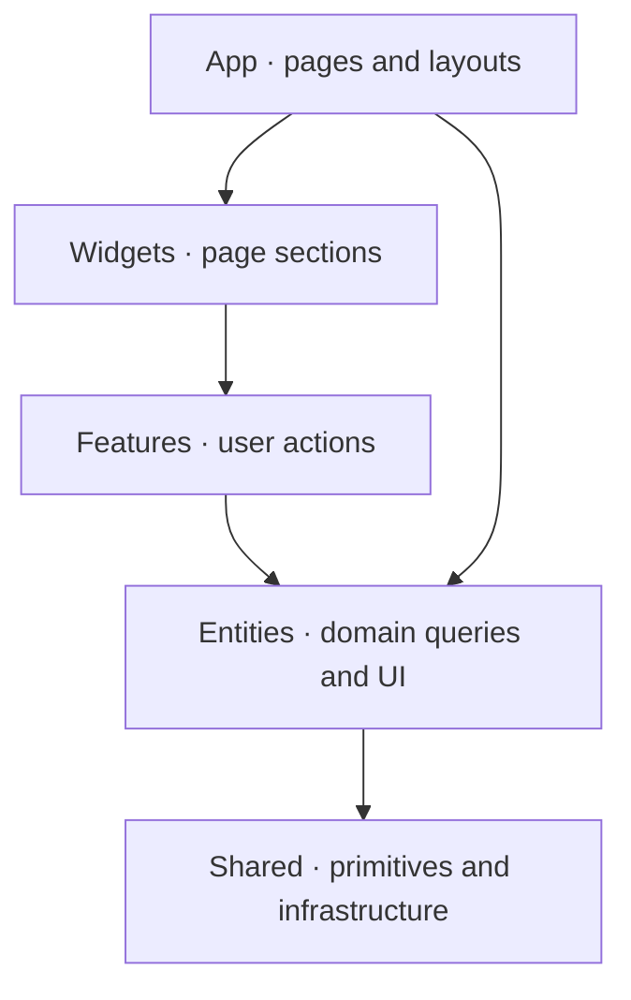
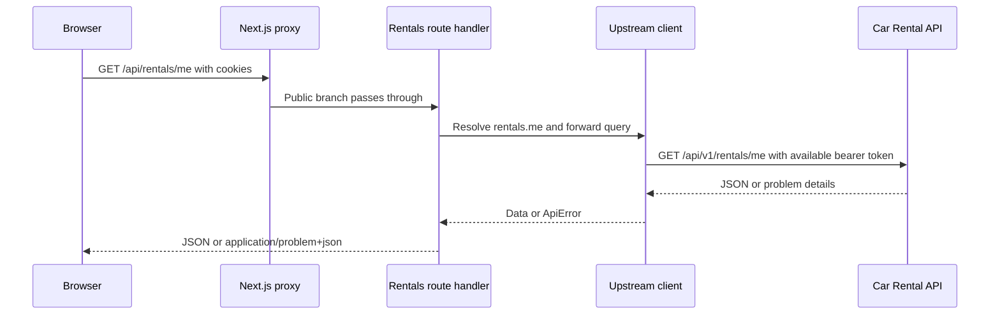
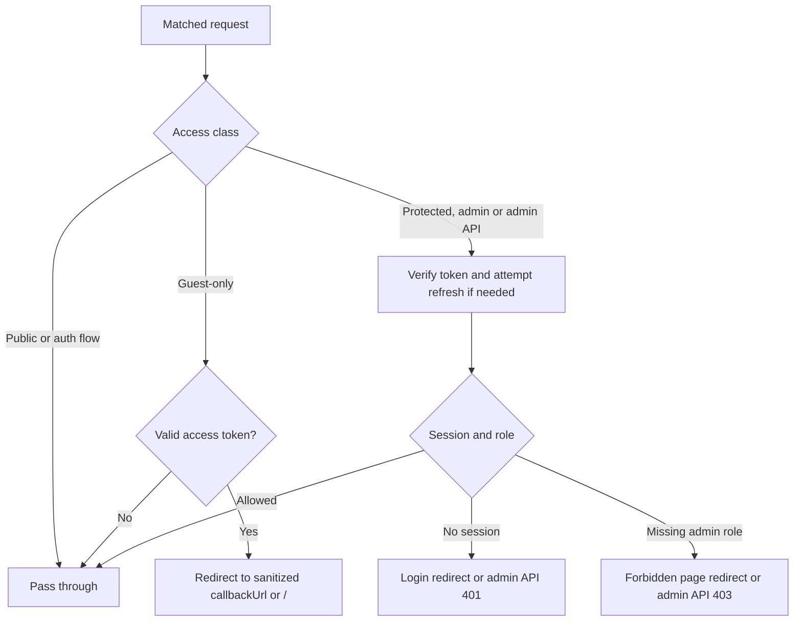
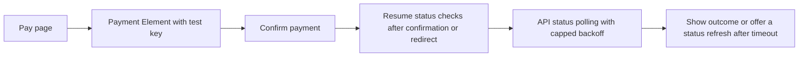

# Architecture diagrams

## Layers and page composition

The app composes widgets, features and entities through their public entry points. Arrows show representative dependency paths. A layer can also use lower layers directly.

The admin rentals page renders its widget directly. The car detail page fetches initial car and calendar data on the server and renders interactive detail UI and a booking widget. Browser queries live in the owning slice's `api/` segment. [Admin rentals page](../../src/app/%28admin%29/admin/rentals/page.tsx) · [Car detail page](../../src/app/cars/%5Bid%5D/page.tsx) · [Car query hooks](../../src/entities/car/api/use-cars.ts)

## Signed-in browser request

Ordinary `/api/*` requests take the public proxy branch. The BFF handler for `/api/rentals/me` invokes the authenticated upstream client, which reads cookies, renews when needed and attaches the access token when available.

[Route classification](../../src/shared/config/route-access.ts) · [Rentals handler](../../src/app/api/rentals/me/route.ts) · [Upstream client](../../src/shared/server/upstream.ts)

## Proxy decisions

The proxy merges renewed cookies into the current request and sets them on its pass-through response. Concurrent server renewals share a promise by hashed refresh token, and successful or rejected results remain available for ten seconds. [Proxy](../../src/proxy.ts) · [Refresh implementation](../../src/shared/server/upstream.ts) · [Route protection](../security/ROUTE_PROTECTION.md)

## Payment confirmation

The pay UI uses Stripe test mode. The client confirms with `redirect: 'if_required'` and can resume polling from a redirect return. [Payment form](../../src/features/pay-rental/ui/payment-element-form.tsx) · [Pay UI](../../src/features/pay-rental/ui/pay-rental.tsx) · [Payment polling hook](../../src/entities/payment/api/use-rental-payment.ts)
