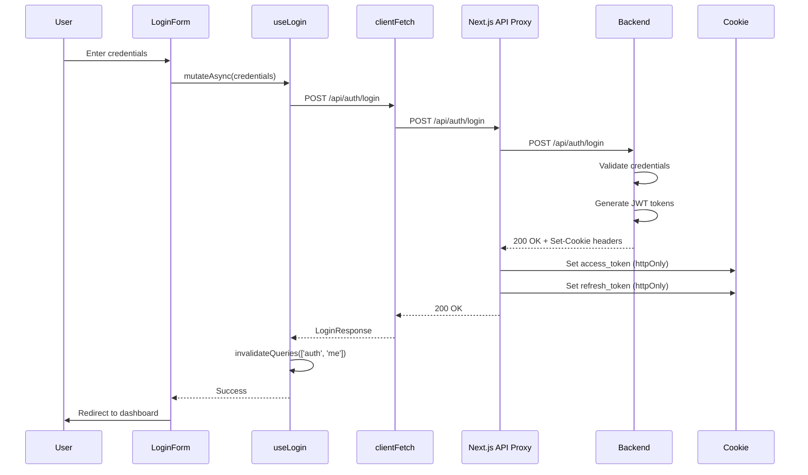
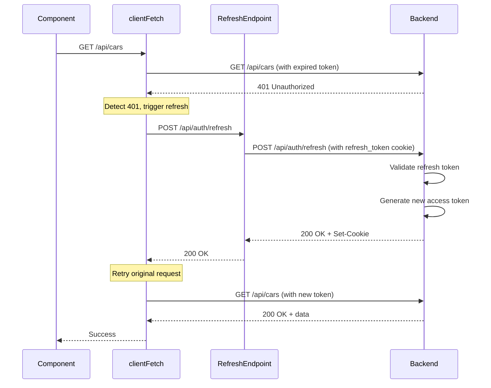
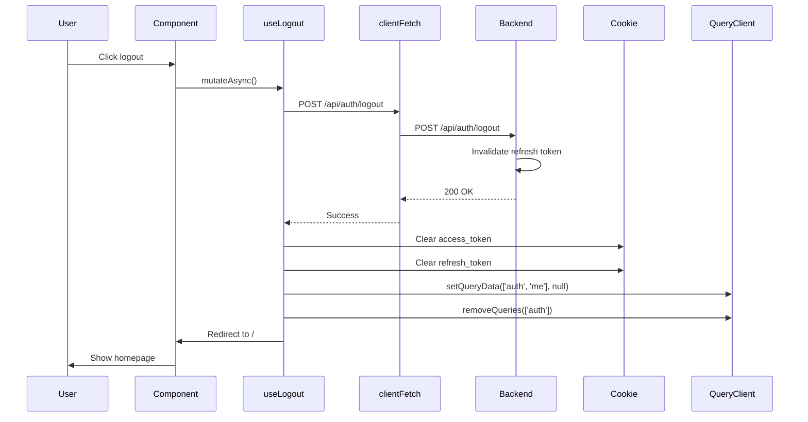
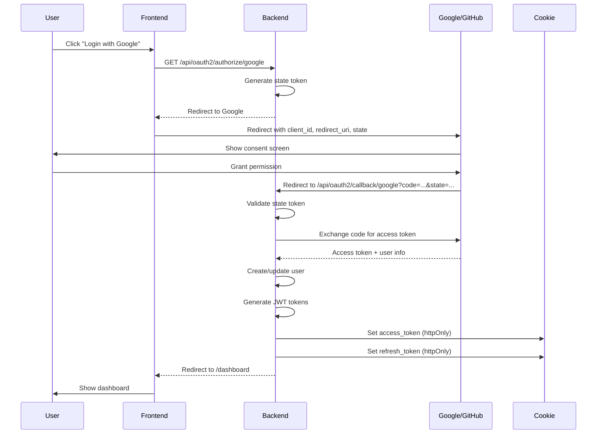

# Authentication Flow Documentation

This document describes the authentication architecture, JWT token flow, OAuth2 integration, and route protection mechanisms in the CarRental frontend.

---

## Overview

The authentication system uses:
- **JWT Tokens** stored in HTTP-Only cookies for security
- **Automatic Token Refresh** on 401 responses (client-side)
- **Route Protection** via Next.js layouts (server-side)
- **OAuth2 Integration** for Google and GitHub login
- **TanStack Query** for auth state management

---

## Architecture

### Feature Structure

```
src/features/auth/
├── api/
│   ├── auth-api.ts       # API functions (login, register, logout)
│   └── endpoints.ts      # Endpoint constants
├── lib/
│   ├── use-auth.ts       # Auth hooks (useAuth, useLogin, useLogout)
│   ├── cookies.ts        # Server-side cookie management
│   ├── jwt-verifier.ts   # JWT token verification
│   └── use-password.ts   # Password validation hooks
├── model/
│   └── types.ts          # Auth types (LoginRequest, User, AuthResponse)
├── ui/
│   ├── login-form.tsx    # Login form component
│   ├── register-form.tsx # Registration form component
│   └── form-error.tsx    # Error display component
└── index.ts              # Public API exports
```

---

## JWT Authentication Flow

### Login Sequence



### Key Components

**1. Login Form (`login-form.tsx`)**
```typescript
const loginMutation = useLogin();

const handleSubmit = async (e: FormEvent) => {
  e.preventDefault();
  
  try {
    await loginMutation.mutateAsync({
      username: formData.username,
      password: formData.password,
    });
    router.push(callbackUrl);
  } catch {
    setFormError('Invalid credentials. Please try again.');
  }
};
```

**2. useLogin Hook (`use-auth.ts`)**
```typescript
export function useLogin() {
  const queryClient = useQueryClient();

  return useMutation({
    mutationFn: loginApi,
    onSuccess: async () => {
      // Invalidate auth cache to fetch fresh user data
      await queryClient.invalidateQueries({ queryKey: authKeys.me() });
    },
  });
}

async function loginApi(credentials: LoginRequest): Promise<LoginResponse> {
  return clientPost<LoginResponse>('/api/auth/login', credentials);
}
```

**3. Next.js API Proxy (`src/proxy.ts`)**

The Next.js API routes act as a proxy to the backend, forwarding requests and setting cookies:

```typescript
// Simplified proxy logic
export async function POST(request: Request) {
  const body = await request.json();
  
  // Forward to backend
  const response = await fetch(`${BACKEND_URL}/api/auth/login`, {
    method: 'POST',
    headers: { 'Content-Type': 'application/json' },
    body: JSON.stringify(body),
  });
  
  // Extract Set-Cookie headers from backend
  const setCookieHeaders = response.headers.getSetCookie();
  
  // Return response with cookies
  return new Response(response.body, {
    status: response.status,
    headers: {
      'Content-Type': 'application/json',
      'Set-Cookie': setCookieHeaders,
    },
  });
}
```

---

## Token Storage Strategy

### HTTP-Only Cookies

Tokens are stored in **HTTP-Only cookies** for security:

```typescript
// src/features/auth/lib/cookies.ts
export async function setAuthTokens(
  accessToken: string,
  refreshToken: string,
  expiresIn: number
): Promise<void> {
  const cookieStore = await cookies();

  cookieStore.set('access_token', accessToken, {
    httpOnly: true,              // Cannot be accessed by JavaScript
    secure: process.env.NODE_ENV === 'production', // HTTPS only in production
    sameSite: 'lax',             // CSRF protection
    path: '/',
    maxAge: expiresIn,           // Access token expiry (15 minutes)
  });

  cookieStore.set('refresh_token', refreshToken, {
    httpOnly: true,
    secure: process.env.NODE_ENV === 'production',
    sameSite: 'lax',
    path: '/',
    maxAge: 60 * 60 * 24 * 7,    // Refresh token expiry (7 days)
  });
}
```

### Security Benefits

| Feature | Benefit |
|---------|---------|
| `httpOnly: true` | Prevents XSS attacks (JavaScript cannot access tokens) |
| `secure: true` | HTTPS-only transmission (production) |
| `sameSite: 'lax'` | CSRF protection (cookies not sent on cross-site requests) |
| `path: '/'` | Cookie available for all routes |

---

## Token Refresh Mechanism

### Automatic Refresh on 401

The client-side API automatically refreshes tokens when receiving 401 responses:



### Implementation

**File:** `src/shared/api/client.ts`

```typescript
export async function clientFetch<T>(
  url: string,
  options: ClientRequestOptions = {},
  isRetry = false
): Promise<T> {
  // ... fetch logic ...

  const response = await fetch(fullUrl.toString(), fetchOptions);

  // Automatic token refresh on 401
  if (
    response.status === 401 && 
    !isRetry && 
    !url.includes('/api/auth/refresh') && 
    !url.includes('/api/auth/login')
  ) {
    const refreshed = await handleTokenRefresh();
    if (refreshed) {
      // Retry original request with new token
      return clientFetch<T>(url, options, true);
    }
  }

  // ... error handling ...
}

async function handleTokenRefresh(): Promise<boolean> {
  // Singleton pattern to prevent concurrent refresh requests
  if (isRefreshing && refreshPromise) {
    return refreshPromise;
  }

  isRefreshing = true;
  refreshPromise = refreshToken();

  try {
    const result = await refreshPromise;
    return result;
  } finally {
    isRefreshing = false;
    refreshPromise = null;
  }
}

async function refreshToken(): Promise<boolean> {
  try {
    const response = await fetch('/api/auth/refresh', {
      method: 'POST',
      credentials: 'include', // Send cookies
      headers: { 'Content-Type': 'application/json' },
    });
    return response.ok;
  } catch {
    return false;
  }
}
```

### Refresh Flow Rules

1. **Only retry once** (`isRetry` flag prevents infinite loops)
2. **Skip refresh for auth endpoints** (login, refresh)
3. **Singleton pattern** (prevent concurrent refresh requests)
4. **Automatic retry** (original request retried after successful refresh)

---

## Route Protection

### Layout-Based Protection

Next.js layouts provide server-side route protection:

#### Protected Routes (USER role required)

**File:** `src/app/(protected)/layout.tsx`

```typescript
export default async function ProtectedLayout({ children }: ProtectedLayoutProps) {
  const token = await getAccessToken();

  if (!token) {
    redirect('/login'); // Redirect to login if not authenticated
  }

  return <>{children}</>;
}
```

**Protected Routes:**
- `/dashboard` - User dashboard
- `/bookings` - User bookings
- `/profile` - User profile settings

#### Admin Routes (ADMIN role required)

**File:** `src/app/(admin)/layout.tsx`

```typescript
export default async function AdminLayout({ children }: AdminLayoutProps) {
  const user = await getCurrentUser();

  if (!user) {
    redirect('/login'); // Not authenticated
  }

  if (!isAdmin(user)) {
    redirect('/forbidden'); // Not authorized (403)
  }

  return (
    <div className="flex min-h-screen">
      <AdminSidebar username={user.username} />
      <main className="flex-1">{children}</main>
    </div>
  );
}

function isAdmin(user: MeResponse | null): boolean {
  return user?.roles.includes('ADMIN') ?? false;
}
```

**Admin Routes:**
- `/admin` - Admin dashboard
- `/admin/fleet` - Fleet management
- `/admin/users` - User management
- `/admin/rentals` - Rental processing

#### Public Routes (No authentication required)

**Route Groups:**
- `(public)` - Home, about, locations
- `(auth)` - Login, register, forgot password

### Route Group Summary

| Route Group | Access Level | Redirect on Failure |
|-------------|--------------|---------------------|
| `(public)` | Public | N/A |
| `(auth)` | Public | N/A |
| `(protected)` | USER role | `/login` |
| `(admin)` | ADMIN role | `/login` (no token) or `/forbidden` (no admin role) |

---

## User State Management

### TanStack Query Integration

Auth state is managed using TanStack Query:

```typescript
export function useAuth(): AuthContextValue {
  const queryClient = useQueryClient();
  const router = useRouter();

  // Fetch current user
  const {
    data: meData,
    isLoading,
    error,
    refetch,
  } = useQuery({
    queryKey: authKeys.me(),
    queryFn: fetchMe,
    retry: 1,
    staleTime: 5 * 60 * 1000,        // 5 minutes
    refetchOnWindowFocus: true,
    refetchOnMount: true,
    refetchInterval: 10 * 60 * 1000, // 10 minutes
  });

  const user: User | null = meData
    ? {
        id: meData.id,
        username: meData.username,
        email: '',
        roles: meData.roles,
      }
    : null;

  const isAuthenticated = !!user;
  const isAdmin = user?.roles?.includes('ADMIN') ?? false;

  return {
    user,
    isLoading,
    isAuthenticated,
    isAdmin,
    error: error as Error | null,
    login,
    logout,
    refresh,
  };
}
```

### Cache Invalidation

```typescript
// After login
await queryClient.invalidateQueries({ queryKey: authKeys.me() });

// After logout
queryClient.setQueryData(authKeys.me(), null);
queryClient.removeQueries({ queryKey: authKeys.all });
```

---

## Logout Flow

### Logout Sequence



### Implementation

```typescript
export function useLogout() {
  const queryClient = useQueryClient();
  const router = useRouter();

  return useMutation({
    mutationFn: logoutApi,
    onSuccess: () => {
      showToast.success('Logged out successfully');
      
      // Clear auth cache
      queryClient.setQueryData(authKeys.me(), null);
      queryClient.removeQueries({ queryKey: authKeys.all });
      
      // Redirect to homepage
      router.push('/');
    },
    onError: () => {
      // Clear cache even on error (fail-safe)
      queryClient.setQueryData(authKeys.me(), null);
    },
  });
}
```

---

## OAuth2 Flow

### Google/GitHub Authentication



### OAuth2 Endpoints

**File:** `src/features/auth/api/endpoints.ts`

```typescript
export const AUTH_ENDPOINTS = {
  oauth: {
    authorize: (provider: string) => 
      `${API_BASE_URL}/api/oauth2/authorize/${provider}`,
    callback: (provider: string) => 
      `${API_BASE_URL}/api/oauth2/callback/${provider}`,
    link: (provider: string) => 
      `${API_BASE_URL}/api/oauth2/link/${provider}`,
  },
};
```

### Supported Providers

- **Google** - `NEXT_PUBLIC_GOOGLE_CLIENT_ID`
- **GitHub** - `NEXT_PUBLIC_GITHUB_CLIENT_ID`

---

## Security Considerations

### 1. Token Storage

✅ **Do:**
- Store tokens in HTTP-Only cookies
- Use `secure: true` in production (HTTPS only)
- Use `sameSite: 'lax'` for CSRF protection

❌ **Don't:**
- Store tokens in localStorage (vulnerable to XSS)
- Store tokens in sessionStorage (vulnerable to XSS)
- Expose tokens to client-side JavaScript

### 2. Token Refresh

✅ **Do:**
- Implement automatic refresh on 401
- Use singleton pattern to prevent concurrent refreshes
- Retry original request after successful refresh

❌ **Don't:**
- Refresh on every request (performance impact)
- Allow infinite retry loops
- Refresh on auth endpoints (login, refresh)

### 3. Route Protection

✅ **Do:**
- Protect routes at the layout level (server-side)
- Verify JWT tokens on the server
- Redirect unauthorized users to `/login`
- Redirect forbidden users to `/forbidden`

❌ **Don't:**
- Rely only on client-side protection
- Trust client-side role checks
- Expose sensitive data without server-side verification

### 4. Password Security

✅ **Do:**
- Enforce minimum password length (6+ characters)
- Validate password strength client-side
- Hash passwords on the backend (bcrypt)

❌ **Don't:**
- Store passwords in plain text
- Send passwords in URL parameters
- Log passwords in console or logs

---

## Backend Alignment

### Spring Security Comparison

| Frontend | Backend (Spring Security) |
|----------|---------------------------|
| HTTP-Only cookies | JWT tokens in cookies |
| Layout-based protection | `@PreAuthorize` annotations |
| `useAuth()` hook | `SecurityContextHolder.getContext()` |
| TanStack Query cache | Spring Security context |
| Automatic token refresh | JWT filter chain |

### Token Format

Both frontend and backend use the same JWT structure:

```json
{
  "sub": "username",
  "userId": 123,
  "roles": ["USER", "ADMIN"],
  "iat": 1706745600,
  "exp": 1706746500
}
```

---

## Troubleshooting

### Issue: 401 Errors Not Refreshing

**Cause:** Token refresh is disabled for certain endpoints or already retrying.

**Solution:** Check that:
1. Endpoint is not `/api/auth/login` or `/api/auth/refresh`
2. Request is not already a retry (`isRetry` flag)
3. Refresh endpoint returns 200 OK

### Issue: Infinite Redirect Loop

**Cause:** Protected layout redirects to `/login`, but `/login` redirects back.

**Solution:** Ensure `/login` is in `(auth)` route group (public access).

### Issue: Admin Routes Accessible by Users

**Cause:** Role check not implemented or JWT not verified.

**Solution:** Verify `isAdmin()` check in `(admin)/layout.tsx`:
```typescript
if (!isAdmin(user)) {
  redirect('/forbidden');
}
```

### Issue: Cookies Not Being Set

**Cause:** CORS configuration or cookie domain mismatch.

**Solution:** Ensure backend has:
```java
@CrossOrigin(origins = "http://localhost:3000", allowCredentials = "true")
```

---

## Related Documentation

- [API Client](../api/API_CLIENT.md) - API client and error handling
- [Route Protection](./ROUTE_PROTECTION.md) - Detailed route protection guide
- [ADR-002: State Management](../adr/ADR-002-state-management.md) - TanStack Query integration
- [Backend Authentication](https://github.com/TheOdrig/car-rental-api/blob/main/docs/security/AUTHENTICATION.md) - Backend auth implementation

---

**Last Updated:** 2026-02-01  
**Maintainer:** Mehmet Akif Uludag
